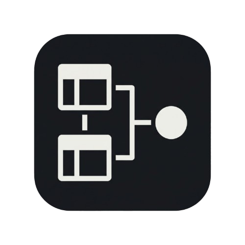
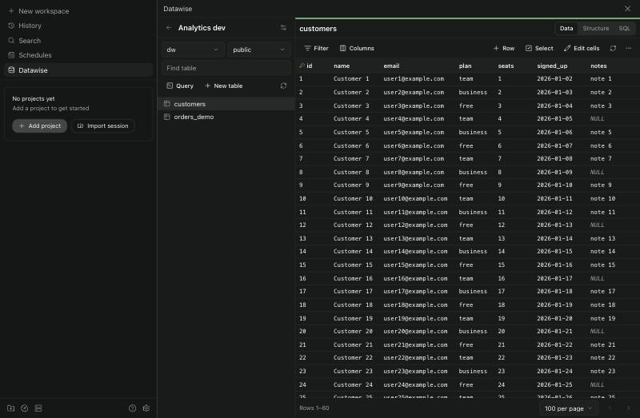
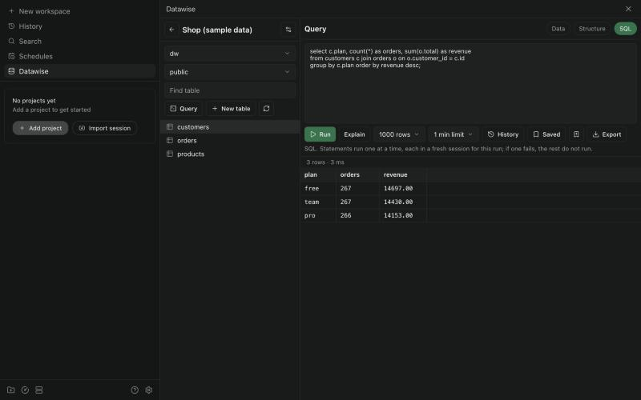

# Datawise

A database client for [Paseo](https://paseo.sh): browse, query, edit, import and export data from PostgreSQL, MySQL, SQLite, SQL Server, Oracle, ClickHouse, MongoDB, Redis, Elasticsearch, Cassandra, DynamoDB and Neo4j. See [OVERVIEW.md](OVERVIEW.md) for what it does and its limits.

Current release: **v0.6.1**. Datawise follows [Semantic Versioning](https://semver.org/); while it is below 1.0.0, a minor release may include breaking changes. See [CHANGELOG.md](CHANGELOG.md).

Requires Paseo 0.16.0-beta.2 or later, and `npm` on the daemon machine's `PATH`.





## Install

```bash
paseo plugin install git:https://github.com/monarchmaisuriya/datawise.git --ref v0.6.1
```

To move to a later release, pick a tag from the [releases page](https://github.com/monarchmaisuriya/datawise/releases) and put it in place of `<tag>`:

```bash
paseo plugin update datawise --ref <tag>
```

To run from a working copy instead, install its dependencies first. Paseo then runs that folder directly, and `paseo plugin reload datawise` picks up edits.

```bash
npm ci --omit=dev --ignore-scripts
paseo plugin install /path/to/datawise
```

Saved connections live in Paseo's `plugin-data/datawise` folder, so they stay in place across updates and reinstalls.

## Agent tools

Paseo agents get these tools while Paseo's "Enable Paseo tools" host setting is on. Each connection is shared with agents only if you choose, and never if it is labelled production. [OVERVIEW.md](OVERVIEW.md) has the full rules.

| Tool | Needs | Does |
| --- | --- | --- |
| `datawise_open` | Nothing shared | Opens a connection, table or query text in the agent's workspace tab; for production, asks you there first |
| `datawise_describe` | Names | Lists shared connections, their tables, and a table's columns |
| `datawise_read` | Rows | Reads rows of a table |
| `datawise_query` | Rows | Runs read statements |
| `datawise_count` | Rows | Counts a table's rows |
| `datawise_explain` | Rows | Shows the plan of one read |
| `datawise_history` | Rows | Lists recent and saved reads |
| `datawise_propose_write` | Proposals | Proposes row inserts, updates and deletes for your approval |
| `datawise_propose_query` | Proposals | Proposes statements for your approval |
| `datawise_write_status` | Nothing shared | Says what became of a proposal |

## Develop

```bash
npm install
npm run typecheck
npm test
paseo plugin reload datawise
```

Drivers are not bundled. Paseo's compiler breaks some of them, so `server/drivers.ts` loads each from the plugin's own `node_modules` on first use.

## Conformance tests

`scripts/conformance.ts` runs the plugin's real RPC handlers against real servers, on Electron's Node, the runtime the plugin gets inside Paseo. It includes attempts to write through read-only connections and values that lose precision if handled carelessly.

```bash
docker compose -f test/compose.yaml up -d
./scripts/conformance.sh sqlite postgres mysql mariadb redis mongodb clickhouse dynamodb
```

Heavy engines have a profile and limited memory. Start them one at a time.

```bash
docker compose -f test/compose.yaml --profile heavy up -d oracle
./scripts/conformance.sh oracle
```

Heavy spec names: `oracle`, `mssql`, `elasticsearch`, `opensearch`, `cassandra`, `neo4j`.

Other specs: `settings` (preferences, labels, views and saved state), `features-<sqlite|postgres|mysql|mariadb|mssql|oracle>` (foreign keys, pending edits, agent tools, approval, attachments), `agent-clickhouse`, `agent-cassandra`, `readonly-folder`, `ssh-keys` and `tls`. Run `./scripts/make-test-certs.sh` before starting the `tls` profile.

Remove everything with:

```bash
docker compose -f test/compose.yaml --profile heavy down -v
```

## Adding an engine

Add a row to `shared/engines.ts`, an adapter implementing `server/adapters/types.ts`, an entry in `server/adapters/index.ts`, and a spec in `scripts/conformance.ts`. The client reads the engine table and needs no change.
